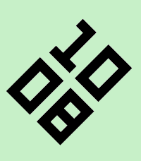
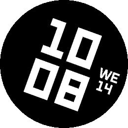

# _watchface (fork)

A fork of Lean 1.4.0 (MIT, by Axel Kark / Kieselleger) for the
_app family, renamed **_watchface**. Two changes vs. upstream:

1. **Day/night awareness, the low-battery way.** The phone sends
   the location once (persisted on the watch); the watch then
   computes sunrise and sunset itself in integer fixed point
   (NOAA approximation, within a few minutes), once a day. The
   minute tick only compares the time against the two stored
   instants — no radio, no GPS, no extra wakeups at runtime.
   While night mode is on (a settings toggle), the face draws
   white on black after sunset; the user's colours return at
   sunrise.
2. **Settings:** a new *Display* section adds a **Font size**
   slider (60–140% in steps of 2; 100% is the upstream size —
   past 100% the digits grow only as far as the tilted block
   still fits) and the Night mode toggle. The colour settings
   are unchanged.

The original README follows.

---

# Lean

*The time meets your eye at the angle your wrist comes to rest.*

     

A Pebble watchface (v1.4.1).

Every watch assumes you can turn your arm until the face lies straight in
front of you. Not everyone can. Lean turns the time instead of your arm:
raise your wrist the way you normally would, see how far the numbers are
off, and set that angle. From then on the time sits level when you glance
at it.

Worn on the left wrist the time turns clockwise, worn on the right it turns
counter-clockwise, anything from 0 to 90 degrees. One switch adds another
180 degrees for wearing the watch the other way round.

An optional date - weekday and day - turns along with the time and goes
wherever the most space is left around the turned digits.

The time is set in LECO 1976, two lines, hours above minutes, drawn far
larger than the built-in version allows. There is no animation; the face is
drawn once a minute and then left alone.

## How the turning works

The Pebble SDK cannot draw rotated text. Lean draws the time upright as
usual, reads the digit pixels from the frame buffer into a 1-bit mask
(clearing them on the way), and writes them back rotated about the centre of
the screen. Each target pixel samples the mask at four points (2x2
supersampling) and is blended between digit and background colour, so the
edges stay smooth at any angle. On the rectangular screen the block is
scaled down if its turned corners would otherwise touch the edge.

## Where the date goes

The date is drawn upright into a second mask and placed in the reading frame
of the time, the coordinate system in which the digits stand upright. There
the screen edge is a tilted rectangle (or a circle) and the time block an
obstacle. A grid search with a pixel-exact refinement finds the spot with the
largest distance to both, for three arrangements: side by side, stacked, and
split (weekday and day placed separately). Splitting only wins if it leaves
noticeably more room. If nothing fits at 28 pt, the search repeats at 22 pt.
The result is cached and only recomputed when the angle, the date or the
settings change.

## Settings

- Worn on - left wrist (clockwise) or right wrist (counter-clockwise).
- Tilt - 0 to 90 degrees in steps of 5.
- Worn upside down - adds 180 degrees. Leave it off if your watch already
  turns the whole display.
- Show the date - weekday and day, off by default.
- Weekday language - the watch language, or English, German, French,
  Spanish, Italian, Portuguese, Dutch.
- Background - the face colour.
- Digits - the colour of the numerals.

12 or 24 hour format follows the watch setting.

## Platforms

- Pebble Time 2 (`emery`)
- Pebble Round 2 (`gabbro`)

## Building

With the [Pebble SDK](https://developer.repebble.com/sdk/):

```bash
pebble build
pebble install --emulator emery
```

The repository can also be imported into CloudPebble as is.

## Release notes

### 1.4.0

Optional date: weekday and day, turned with the time and placed in the
largest free space around it. The weekday follows the watch language, or the
one you pick.

### 1.0.0

First release.

## License

MIT License, see [LICENSE](LICENSE). The bundled fonts are not covered by it and
remain under their own licenses.
